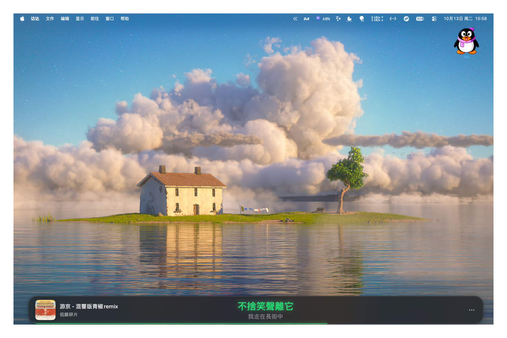

<p align="center">
  
</p>

<h1 align="center">Spotify Lyricify for Mac</h1>

<p align="center">为 Spotify for Mac 设计的轻量、程序坞高度同步歌词悬浮条。</p>

<p align="center">
  <a href="README.md">English</a> | <strong>中文</strong>
</p>

<p align="center">
  
  
  <a href="LICENSE"></a>
  <a href="https://github.com/Phinsin666/spotify-lyricify-for-mac/releases"></a>
</p>



默认使用繁体中文界面，可在设置中切换为简体中文。

## 功能

- 自动读取 Spotify 当前播放的歌曲、歌手、专辑和播放进度
- 从 QQ 音乐、网易云音乐与 LRCLIB 匹配同步歌词
- 外语歌曲在歌词源提供译文时显示原文＋中文逐行翻译
- 中文歌曲显示当前歌词与下一句歌词
- 繁体中文／简体中文切换
- 歌名过长时自动横向滚动
- 自动获取专辑封面
- 适配浅色、深色和跟随系统外观
- 自定义字体缩放、透明度、模糊效果和强调色
- 无边框悬浮窗口，支持鼠标拖动和 macOS 三指拖移
- 支持所有桌面与全屏辅助显示
- Dock 图标和菜单栏快捷控制

## 系统要求

- macOS 14 Sonoma 或更高版本
- Spotify for Mac
- Xcode 16 或兼容 Swift 6 的命令行工具（仅源码构建需要）

## 安装

```bash
git clone https://github.com/Phinsin666/spotify-lyricify-for-mac.git
cd spotify-lyricify-for-mac
./scripts/build-app.sh
open dist
```

将 `Spotify Lyricify for Mac.app` 拖入“应用程序”文件夹，然后启动即可。

首次运行时，macOS 会询问是否允许本应用控制 Spotify。该权限只用于读取当前播放信息和执行播放／暂停、上一首、下一首操作，可在“系统设置 → 隐私与安全性 → 自动化”中管理。

## 使用方法

1. 打开 Spotify 并开始播放歌曲。
2. 启动 Spotify Lyricify for Mac。
3. 歌词条会自动出现在屏幕下方，可直接拖到其他位置。
4. 点击歌词条右侧的 `…` 打开设置。
5. 菜单栏图标可用于重新显示歌词窗口、控制 Spotify 或退出应用。

如果安装了菜单栏折叠工具，新图标可能会被自动收入隐藏区域。展开隐藏区域后，可按住 Command 将图标拖到常驻位置。

## 歌词与翻译

应用会比较多个歌词来源的匹配结果，并优先使用包含可用中文逐行翻译的版本。歌词翻译来自歌词服务本身，不会将歌曲内容上传至生成式 AI。

并非所有歌曲都提供同步歌词或翻译；不同地区、版本和发行信息也可能影响匹配结果。本项目不储存或分发歌词数据库。

## 开发与构建

```bash
swift run DockLyrics
swift build
swift build -c release
./scripts/build-app.sh
```

也可以使用 Xcode 打开 `Package.swift`。构建脚本会在 `dist/` 中生成本地临时签名的 `.app`。公开分发时，维护者仍需使用自己的 Apple Developer 证书完成签名与公证。

## 项目结构

```text
Sources/DockLyrics/
├── DockLyricsApp.swift           # 应用、窗口和菜单栏入口
├── PlaybackModel.swift           # 播放状态与歌词时间轴
├── SpotifyNowPlayingClient.swift # Spotify AppleScript 集成
├── LyricsProvider.swift          # 多歌词源查询、排序与翻译配对
├── ArtworkResolver.swift         # 专辑封面解析
├── LyricsBarView.swift           # 歌词悬浮条
└── SettingsView.swift            # 设置界面
```

## 隐私

- 不需要 Spotify Web API Client ID。
- 不收集账号、播放历史或个人数据。
- Spotify 播放信息通过本机 AppleScript 读取。
- 歌曲标题、歌手、专辑和时长会发送给歌词服务用于搜索匹配。

## 贡献

欢迎提交 Issue 和 Pull Request。提交代码前请确保 `swift build` 通过，并尽量保持界面文本同时兼容繁体与简体中文。详情见 [CONTRIBUTING.md](CONTRIBUTING.md)。

## 免责声明

Spotify Lyricify for Mac 是非官方开源项目，与 Spotify、Lyricify、腾讯音乐或网易云音乐没有隶属、授权或合作关系。Spotify、QQ 音乐、网易云音乐及 Lyricify 等名称和商标归各自权利人所有。歌词及翻译的权利归原作者和相关权利人所有，请遵守所在地法律及对应服务条款。

## 开源协议

[MIT](LICENSE)
